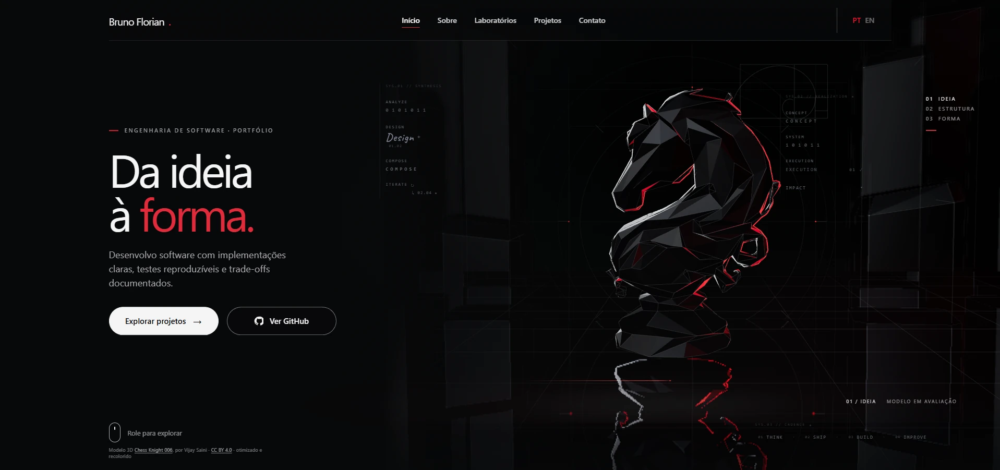

<div align="right"><sub><a href="#english">ENGLISH</a> · <a href="#portugues">PORTUGUÊS</a></sub></div>

<p align="center">
  
</p>

<p align="center"><sub>HOME / THREE.JS SCENE / PT-BR</sub></p>

<div align="center">

# Bruno Florian

**Software engineering, from thought to form.**<br />
**Engenharia de software, da ideia à forma.**

<a href="https://brunoflorian.pages.dev/"><strong>OPEN THE LIVE PORTFOLIO ↗</strong></a>
&nbsp; · &nbsp;
<a href="https://brunoflorian.pages.dev/en/">English</a>
&nbsp; · &nbsp;
<a href="https://brunoflorian.pages.dev/pt-br/">Português</a>

</div>

---

## English

A bilingual portfolio for software engineering work, experiments, and ideas. Its Home brings a chess-inspired 3D scene together with the portfolio's projects and engineering labs.

The site uses static HTML, CSS, and JavaScript modules, with Three.js for the Home scene. It supports pointer and scroll interaction, keyboard navigation, reduced motion, and a static fallback when WebGL is unavailable.

### Technologies

`HTML` · `CSS` · `JavaScript ES modules` · `Three.js`<br />
`Node.js` runs the local preview server; the site has no package-install or build step.

## Português

Um portfólio bilíngue de engenharia de software, experimentos e ideias. A Home combina uma cena 3D inspirada no xadrez com projetos e laboratórios de engenharia.

O site usa HTML, CSS e módulos JavaScript estáticos, com Three.js na cena da Home. Há interação por ponteiro e rolagem, navegação por teclado, suporte à preferência por movimento reduzido e apresentação estática alternativa quando o WebGL não está disponível.

### Tecnologias

`HTML` · `CSS` · `JavaScript ES modules` · `Three.js`<br />
`Node.js` executa o preview local; o site não exige instalação de pacotes nem etapa de build.

## Navigate / Navegue

|  | Home | Labs | Projects / Projetos | About / Sobre | Contact / Contato |
|---|---|---|---|---|---|
| **English** | [Open](https://brunoflorian.pages.dev/en/) | [Open](https://brunoflorian.pages.dev/en/labs/) | [Open](https://brunoflorian.pages.dev/en/projects/) | [Open](https://brunoflorian.pages.dev/en/about/) | [Open](https://brunoflorian.pages.dev/en/contact/) |
| **Português** | [Abrir](https://brunoflorian.pages.dev/pt-br/) | [Abrir](https://brunoflorian.pages.dev/pt-br/laboratorios/) | [Abrir](https://brunoflorian.pages.dev/pt-br/projetos/) | [Abrir](https://brunoflorian.pages.dev/pt-br/sobre/) | [Abrir](https://brunoflorian.pages.dev/pt-br/contato/) |

## Run locally / Executar localmente

```powershell
git clone https://github.com/devbrunoflorian/portfolio.git
cd portfolio
node tools/serve-local.mjs
```

Open one of these pages:

- English: <http://127.0.0.1:4173/en/>
- Português: <http://127.0.0.1:4173/pt-br/>

Press `Ctrl+C` in the terminal to stop the preview server.

## Project structure

```text
portfolio/
├── assets/   Shared styles, scripts, Three.js modules, and model assets
├── en/       English pages
├── pt-br/    Brazilian Portuguese pages
└── tools/    Local preview server
```

## Model attribution / Atribuição do modelo

The Home uses an optimized and recolored derivative of “Chess Knight 006” by [Vijay Saini](https://skfb.ly/pEJVJ), licensed under [CC BY 4.0](https://creativecommons.org/licenses/by/4.0/). See [`assets/models/README.md`](assets/models/README.md) for details.

A Home usa uma versão otimizada e recolorida do modelo “Chess Knight 006”, de [Vijay Saini](https://skfb.ly/pEJVJ), licenciada sob [CC BY 4.0](https://creativecommons.org/licenses/by/4.0/). Consulte [`assets/models/README.md`](assets/models/README.md) para detalhes.

---

<p align="center"><sub>Designed and built by Bruno Florian · <a href="https://github.com/devbrunoflorian">GitHub</a></sub></p>