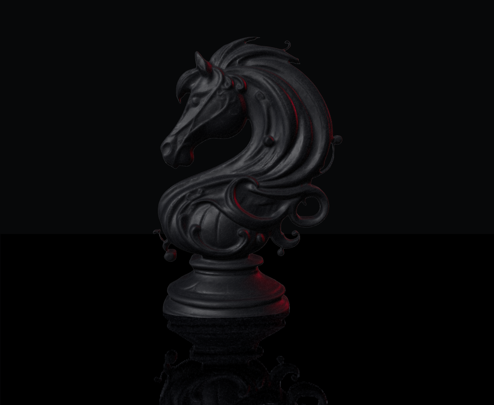

<div align="center">

# Bruno Florian

**Software engineering, from thought to form.**

An evolving bilingual portfolio for engineering work, experiments, and ideas.

<a href="https://brunoflorian.pages.dev/"><strong>Open the live portfolio →</strong></a>
&nbsp; · &nbsp;
<a href="https://brunoflorian.pages.dev/en/">English</a>
&nbsp; · &nbsp;
<a href="https://brunoflorian.pages.dev/pt-br/">Português</a>

</div>

<p align="center">
  
</p>

<p align="center"><sub>Current temporary hero model — artistic direction and site are still evolving.</sub></p>

## Find your way

| Section | Português | English |
|---|---|---|
| Home | [Abrir](https://brunoflorian.pages.dev/pt-br/) | [Open](https://brunoflorian.pages.dev/en/) |
| Labs | [Laboratórios](https://brunoflorian.pages.dev/pt-br/laboratorios/) | [Labs](https://brunoflorian.pages.dev/en/labs/) |
| Projects | [Projetos](https://brunoflorian.pages.dev/pt-br/projetos/) | [Projects](https://brunoflorian.pages.dev/en/projects/) |
| About | [Sobre](https://brunoflorian.pages.dev/pt-br/sobre/) | [About](https://brunoflorian.pages.dev/en/about/) |
| Contact | [Contato](https://brunoflorian.pages.dev/pt-br/contato/) | [Contact](https://brunoflorian.pages.dev/en/contact/) |

## What you'll find

- A cinematic Home built around a 3D chess knight, with pointer and scroll interaction.
- Direct navigation to engineering labs, projects, background, and contact.
- Portuguese (Brazil) and English versions.
- Keyboard navigation, reduced-motion behavior, and a readable fallback when WebGL is unavailable.

The portfolio is being built incrementally. Some sections are still in progress, and public project descriptions are kept to verifiable facts.

## Run it locally

The site is static and has no package-install or build step. You only need Node.js; the current preview workflow was verified with Node 24.

From PowerShell:

```powershell
cd "C:\Users\bruno\CV Manager\engineering-labs\portfolio"
node .\tools\serve-local.mjs
```

Then open one of these URLs:

- Portuguese: <http://127.0.0.1:4173/pt-br/>
- English: <http://127.0.0.1:4173/en/>

The server prints the preview URL in the terminal. Press `Ctrl+C` there when you're done.

## Project map

```text
portfolio/
├── assets/          Shared styles, scripts, model, and local vendor files
├── pt-br/           Brazilian Portuguese pages
├── en/              English pages
└── tools/           Local static preview server
```

## Current hero model

“Chess Knight 006” by [Vijay Saini](https://skfb.ly/pEJVJ), licensed under [CC BY 4.0](https://creativecommons.org/licenses/by/4.0/). The portfolio uses an optimized and recolored derivative as a temporary hero model. See [`assets/models/README.md`](assets/models/README.md) for attribution and modification details.

---

<p align="center"><sub>Designed and built by Bruno Florian · <a href="https://github.com/devbrunoflorian">GitHub</a></sub></p>
