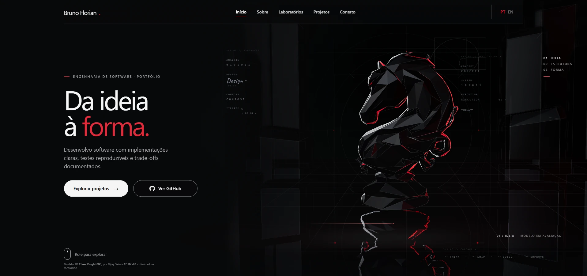

<div align="right"><sub><a href="#english">ENGLISH</a> · <a href="#portugues">PORTUGUÊS</a></sub></div>

<p align="center">
  
</p>

<p align="center"><sub>HOME / THREE.JS SCENE / PT-BR</sub></p>

<div align="center">

# Bruno Florian

**Software engineering, from thought to form.**<br />
**Engenharia de software, da ideia à forma.**

<a href="https://brunoflorian.pages.dev/"><strong>OPEN THE LIVE PORTFOLIO ↗</strong></a>
&nbsp; · &nbsp;
<a href="https://brunoflorian.pages.dev/en/">English</a>
&nbsp; · &nbsp;
<a href="https://brunoflorian.pages.dev/pt-br/">Português</a>

</div>

---

## English

A bilingual portfolio for software engineering work, experiments, and ideas. Its Home brings a chess-inspired 3D scene together with the portfolio's projects and engineering labs.

The site is being migrated to Astro with TypeScript and selective React components. Labs is the first migrated page: React owns the controls and selected-lab content, while the existing Three.js and Canvas modules own rendering. Other pages retain their static HTML and JavaScript modules.

Contact Beta 1 uses five photographic atmospheres with optional, pausable transitions and a static fallback. Scene controls let visitors select an atmosphere; continuous rain, moving commuters, and audio are not implemented.


### Technologies

`Astro` · `TypeScript` · `React` · `CSS` · `JavaScript ES modules` · `Three.js`<br />
Node.js 24.22.1 and npm are required. The build generates static files; there is no application server in production.

## Português

Um portfólio bilíngue de engenharia de software, experimentos e ideias. A Home combina uma cena 3D inspirada no xadrez com projetos e laboratórios de engenharia.

O site está em migração para Astro com TypeScript e componentes React seletivos. Labs é a primeira página migrada: React controla a interface e o conteúdo do laboratório selecionado, enquanto os módulos existentes de Three.js e Canvas controlam o desenho. As outras páginas mantêm HTML estático e módulos JavaScript.

A Contact Beta 1 usa cinco atmosferas fotográficas, transições opcionais com pausa e fallback estático. Os controles da cena permitem escolher uma atmosfera; chuva contínua, passageiros em movimento e áudio ainda não estão implementados.


### Tecnologias

`Astro` · `TypeScript` · `React` · `CSS` · `JavaScript ES modules` · `Three.js`<br />
É necessário Node.js 24.22.1 e npm. O build gera arquivos estáticos; não há servidor de aplicação em produção.

## Navigate / Navegue

|  | Home | Labs | Projects / Projetos | About / Sobre | Contact / Contato |
|---|---|---|---|---|---|
| **English** | [Open](https://brunoflorian.pages.dev/en/) | [Open](https://brunoflorian.pages.dev/en/labs/) | [Open](https://brunoflorian.pages.dev/en/projects/) | [Open](https://brunoflorian.pages.dev/en/about/) | [Open](https://brunoflorian.pages.dev/en/contact/) |
| **Português** | [Abrir](https://brunoflorian.pages.dev/pt-br/) | [Abrir](https://brunoflorian.pages.dev/pt-br/laboratorios/) | [Abrir](https://brunoflorian.pages.dev/pt-br/projetos/) | [Abrir](https://brunoflorian.pages.dev/pt-br/sobre/) | [Abrir](https://brunoflorian.pages.dev/pt-br/contato/) |

## Run locally / Executar localmente

```powershell
git clone https://github.com/devbrunoflorian/portfolio.git
cd portfolio
npm ci
npm run dev
```

Open one of these pages:

- English: <http://127.0.0.1:4173/en/>
- Português: <http://127.0.0.1:4173/pt-br/>

Press `Ctrl+C` in the terminal to stop the preview server.

The legacy root-level preview server does not serve the migrated Labs page. Use the npm commands above.

```powershell
npm run check
npm test
npm run build
npm run check:build
npm run preview
```

Browser regression checks for Labs require Playwright's Chromium:

```powershell
npx playwright install chromium
npm run test:labs
```

The general Node suite currently has four failing About GPU geometry cases; they are not skipped. The Labs browser suite runs against the production build. It checks selection, input, fallbacks and renderer lifecycle; it does not certify performance on physical mobile devices.

For static hosting, use `npm run build` and publish only `dist`. The build preserves the remaining page URLs and stages their referenced assets. Source files, development tools and experiments are not deployment inputs.

## Project structure

```text
portfolio/
├── src/      Astro pages, shared layout, localized data and React controls
├── assets/   Styles, existing scene modules and model assets
├── en/       English pages awaiting migration
├── pt-br/    Portuguese pages awaiting migration
├── tests/    Node tests and Labs browser regressions
├── tools/    Public asset staging and build checks
└── dist/     Generated static deployment output (not committed)
```

## Model attribution / Atribuição do modelo

The Home uses an optimized and recolored derivative of “Chess Knight 006” by [Vijay Saini](https://skfb.ly/pEJVJ), licensed under [CC BY 4.0](https://creativecommons.org/licenses/by/4.0/). See [`assets/models/README.md`](assets/models/README.md) for details.

A Home usa uma versão otimizada e recolorida do modelo “Chess Knight 006”, de [Vijay Saini](https://skfb.ly/pEJVJ), licenciada sob [CC BY 4.0](https://creativecommons.org/licenses/by/4.0/). Consulte [`assets/models/README.md`](assets/models/README.md) para detalhes.

---

<p align="center"><sub>Designed and built by Bruno Florian · <a href="https://github.com/devbrunoflorian">GitHub</a></sub></p>
